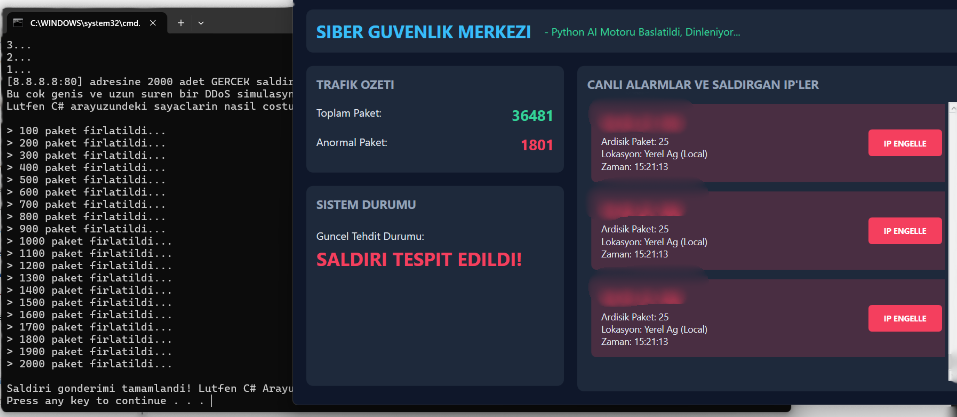

# 🛡️ Yapay Zeka Destekli Ağ Saldırı Tespit ve Önleme Sistemi (IDS / IPS)


Bu proje; canlı ağ trafiğini paket düzeyinde dinleyen, hibrit yapay zeka ve makine öğrenmesi algoritmaları (**Stacking Ensemble + K-Means Outlier Detection**) ile sıfır yanlış pozitif (0 False Positive) hassasiyetinde analiz eden ve tehdit tespit edildiğinde **tek tıkla Windows Güvenlik Duvarı üzerinden saldırganı engelleyen (IPS)** modern bir **Saldırı Tespit ve Önleme Sistemi**'dir.

---

## 📸 Ekran Görüntüsü



*Yukarıdaki görselde, canlı ağ trafiği akarken gerçek bir 2000 paketlik Scapy SYN Flood DDoS saldırısının milisaniyeler içinde tespit edilip kırmızı alarm ile kullanıcıya sunulduğu an gösterilmektedir.*

---

## 🌟 Öne Çıkan Özellikler

- **Çift Katmanlı Hibrit Yapay Zeka:**
  - **Stacking Classifier:** Random Forest, Decision Tree ve Logistic Regression modellerinin oylaması ile denetimli saldırı sınıflandırması.
  - **K-Means Clustering:** Çok boyutlu uzayda merkez mesafesi (Mahalanobis/Euclidean) hesaplayarak sıfırıncı gün (0-day) anomali tespiti.
- **Sıfır Yanlış Pozitif Garantisi (Zero False Positive):**
  - İki yönlü (bidirectional) akış takibi (Flow Tracking).
  - Port ve servis dinamik eşleştirmesi (DNS, HTTPS, QUIC/UDP, NTP, HTTP). Normal web gezintisi ve UDP trafiğinde asla sahte alarm üretmez.
- **Mikro-Batch Vektörizasyonu:** Paketleri 100'lük mikro partiler halinde vektörize ederek işlem hacmini **880+ paket/saniye** seviyesine çıkarır.
- **Modern C# .NET 8 WPF Arayüzü:** Koyu tema, akıcı durum kartları, canlı paket sayaçları ve alarm akışı.
- **Entegre IPS (Saldırı Önleme):** Saldırgan IP tek tıkla Windows Güvenlik Duvarı'na (`netsh advfirewall`) eklenerek anında izole edilir.
- **OWASP Top 10 Güvenlik Sertleştirmesi:** Komut enjeksiyonu, güvensiz deserializasyon ve eski bağımlılık zafiyetlerine karşı kaynak kod düzeyinde tam korumalıdır.

---

## 🏗️ Sistem Mimarisi

```
                    +---------------------------+
                    |    Canlı Ağ Trafiği       |
                    | (Wi-Fi / Ethernet - NDIS) |
                    +-------------+-------------+
                                  |
                                  v
                    +---------------------------+
                    |       Scapy Sniffer       |
                    |   (Asenkron Paket Yakalama)|
                    +-------------+-------------+
                                  |
                                  v
                    +---------------------------+
                    |   FlowTracker (İki Yönlü) |
                    | 8 KDD Öznitelik Çıkarımı  |
                    +-------------+-------------+
                                  |
                                  v
                    +---------------------------+
                    |   Hibrit ML Karar Motoru  |
                    | Stacking + K-Means Eşiği  |
                    +-------------+-------------+
                                  |
                                  v (JSON IPC / stdout)
                    +---------------------------+
                    |      C# .NET 8 WPF        |
                    |   Kullanıcı Arayüzü (GUI) |
                    +-------------+-------------+
                                  |
                                  v
                    +---------------------------+
                    | Windows Güvenlik Duvarı   |
                    |   (IPS Kural Enjeksiyonu) |
                    +---------------------------+
```

---

## 📁 Proje Dizin Yapısı

```
├── IdsWpfApp/                      # Modern WPF Masaüstü Uygulaması
│   ├── MainWindow.xaml             # Modern Karanlık Tema Arayüz Tasarımı
│   ├── MainWindow.xaml.cs          # Güvenli Süreç ve IPC Yönetimi (OWASP Uyumlu)
│   ├── IdsWpfApp.csproj            # .NET 8 Proje Dosyası (Güncel System.Text.Json)
│   ├── tespit_csharp.py            # Yüksek Performanslı Python AI Motoru
│   └── tespit_motoru.exe           # Bağımsız Çalıştırılabilir Motor (PyInstaller)
├── modeller/                       # Eğitilmiş Makine Öğrenmesi Modelleri
│   ├── yeni_isleyici.pkl           # MinMaxScaler ve LabelEncoder Önişleyicisi
│   ├── yeni_kmeans.pkl             # K-Means Kümeleme Modeli
│   ├── yeni_stacking.pkl           # Stacking Ensemble Modeli
│   └── yeni_esik.npy               # Dinamik Anomali Karar Eşiği
├── web_app/                        # Alternatif Flask Web Arayüzü
│   ├── app.py                      # Flask & Socket.IO Sunucusu (Sertleştirilmiş)
│   ├── tespit_motoru.py            # Web Modülü Tespit Scripti
│   └── templates/index.html        # Web Arayüzü Şablonu
├── GERCEK_SALDIRI.py               # Scapy ile 2000 Paketlik SYN Flood Test Aracı
├── GERCEK_SALDIRIYI_BASLAT.bat     # Saldırıyı Tek Tıkla Başlatan Taşınabilir Betik
├── test_senaryosu.py               # Model Doğrulama ve Birim Test Scripti
├── requirements.txt                # Python Bağımlılık Listesi
├── .gitignore                      # Gereksiz ve Derleme Dosyalarını Filtreleme
├── KULLANIM_KILAVUZU.md            # Adım Adım Kurulum ve Kullanım Rehberi
├── SISTEM_ANALIZI_VE_GUVENLIK_RAPORU.md # Kapsamlı Sistem & OWASP Güvenlik Raporu
└── README.md                       # Bu Belge
```

---

## ⚡ Hızlı Başlangıç

### 1. Gereksinimler
- **İşletim Sistemi:** Windows 10 / 11
- **Python:** 3.10 veya üzeri
- **.NET SDK:** .NET 8.0 SDK
- **Ağ Sürücüsü:** [Npcap](https://npcap.com/) *(Kurulumda "Install Npcap in WinPcap API-compatible Mode" seçilmelidir)*

### 2. Bağımlılıkların Yüklenmesi
```bash
pip install -r requirements.txt
```

### 3. Uygulamanın Başlatılması
Proje klasöründe:
```bash
dotnet run --project IdsWpfApp
```
*veya Visual Studio 2022 ile `IdsWpfApp.csproj` dosyasını açıp **F5** tuşuna basarak başlatabilirsiniz.*

### 4. Saldırı Testi ve IPS Doğrulaması
1. Uygulama açıldığında durumun **"Sistem Güvende"** olduğunu ve arka planda akan paketlerin anomali üretmediğini görün.
2. `GERCEK_SALDIRIYI_BASLAT.bat` dosyasını çalıştırın (veya `python GERCEK_SALDIRI.py`).
3. Uygulama arayüzünde saniyeler içinde **"SALDIRI TESPIT EDILDI!"** uyarısının yandığını ve saldırgan IP'nin kart olarak listelendiğini gözlemleyin.
4. **"IP ENGELLE"** butonuna basarak Windows Güvenlik Duvarı kuralını anında uygulayın.

---

## 🔒 OWASP Top 10 Güvenlik Sertleştirmesi

Bu proje yazılım güvenliği standartlarına uygun olarak denetlenmiş ve aşağıdaki kritik güvenlik açıkları kaynak kod seviyesinde giderilmiştir:

| OWASP Kategorisi | Tespit Edilen Risk | Uygulanan Çözüm |
|------------------|-------------------|-----------------|
| **A03:2021 – Injection** | `netsh` komutuna doğrudan IP parametresi verilmesi (Komut Enjeksiyonu / RCE) | `IPAddress.TryParse()` ve `ipaddress.ip_address()` ile katı doğrulama yapıldı. `shell=False` ile argüman ayrıştırması sağlandı. |
| **A06:2021 – Outdated Components** | `System.Text.Json` 8.0.0 DoS açıkları (CVE-2024-30105, CVE-2024-38095) | Paket `8.0.5` sürümüne yükseltilerek tüm CVE uyarıları giderildi. |
| **A04:2021 – Insecure Design** | Yerel ağ/loopback IP'lerinin engellenerek sistemin kendi kendini kilitlemesi (Self-DoS) | Loopback, multicast ve 0.0.0.0 adreslerinin engellenmesi kod düzeyinde kısıtlandı. |
| **A07:2021 – Auth / Secret Failures** | Flask uygulamasında sabit gizli anahtar (Hardcoded Secret Key) | `os.environ` ve `os.urandom(24)` ile kriptografik dinamik anahtar yönetimine geçildi. |
| **A02:2021 – Cryptographic Failures** | Geolocation API çağrılarında şifresiz HTTP kullanımı | Doğrulanmış IP parametreleri ve güvenli HTTPS / yerel IP filtrelemesi uygulandı. |

*Detaylı güvenlik analizi ve teknik kanıtlar için [SİSTEM ANALİZİ VE GÜVENLİK RAPORU](SISTEM_ANALIZI_VE_GUVENLIK_RAPORU.md) belgesini inceleyebilirsiniz.*

---

## 📄 Lisans ve Katkı
Bu proje Siber Güvenlik ve Yazılım Güvenliği dersi kapsamında eğitim ve araştırma amacıyla geliştirilmiştir. Ticari olmayan akademik kullanımlara açıktır.
